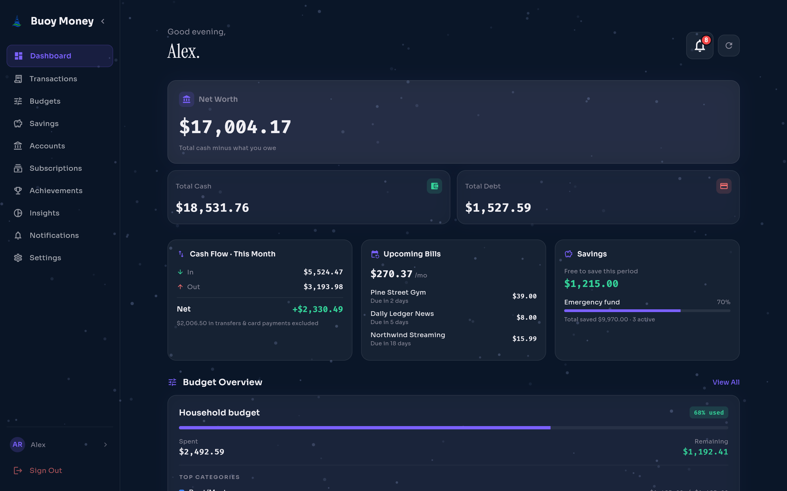
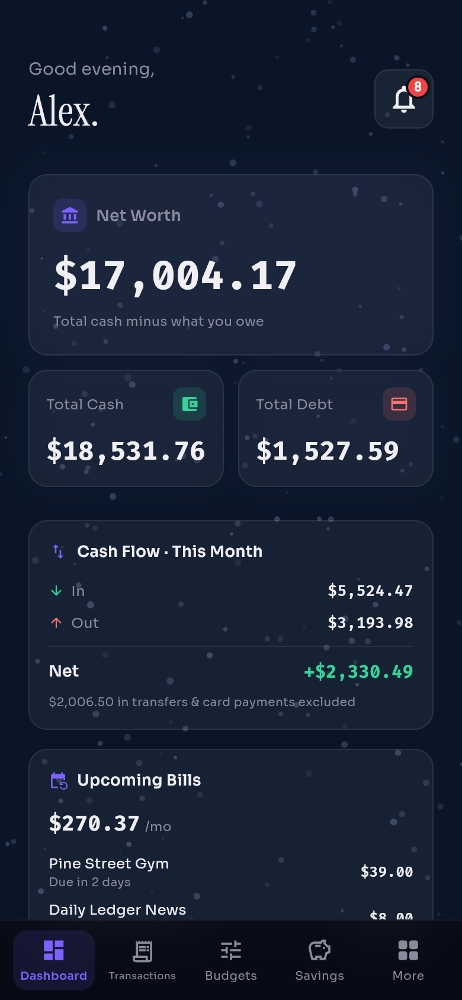
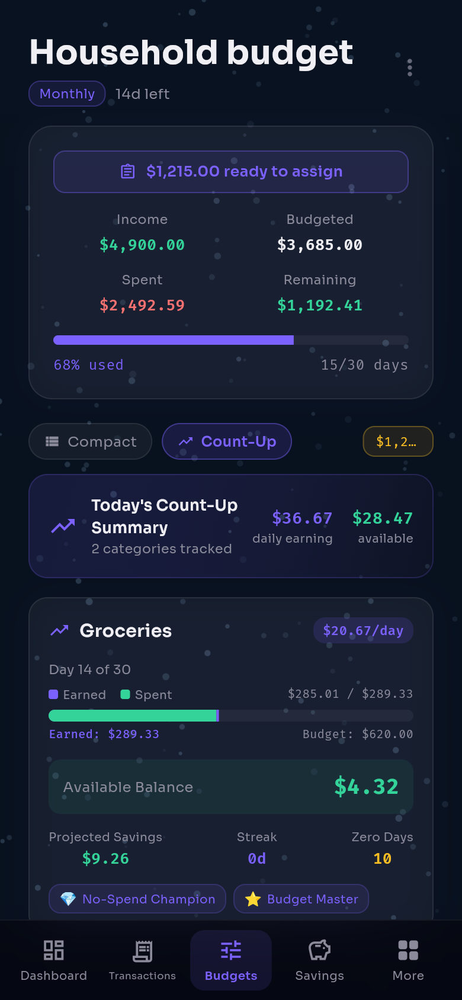
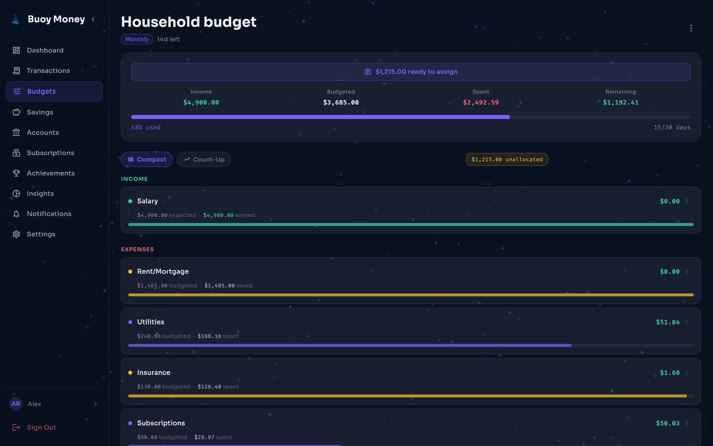
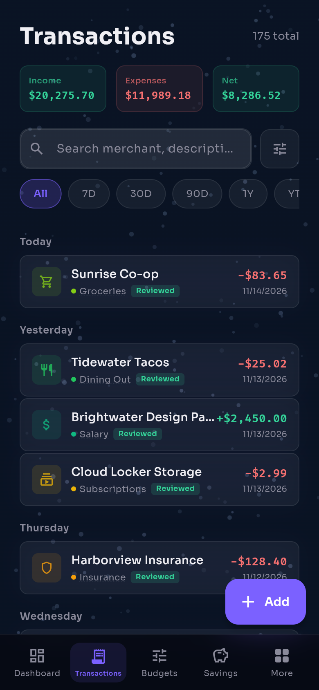
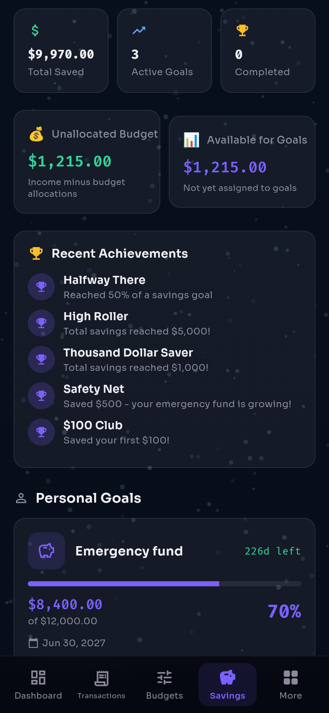

<div align="center">
  
  <h1>Buoy Money</h1>
  <p><strong>A budgeting app you run on your own server. Your budget counts up, not down.</strong></p>
  <p>
    <a href="https://github.com/BuoyMoney/buoy-money/actions/workflows/ci.yml"></a>
    <a href="https://github.com/BuoyMoney/buoy-money/releases/latest"></a>
    <a href="LICENSE"></a>
    <a href="https://github.com/BuoyMoney/buoy-money/pkgs/container/buoy-money"></a>
    <a href="https://github.com/BuoyMoney/buoy-money/stargazers"></a>
    <a href="https://github.com/BuoyMoney/buoy-money/commits/main"></a>
  </p>
</div>

<p align="center">
  
  
  
</p>
<p align="center"><sub>Every screenshot here shows an invented household on a throwaway local install.</sub></p>

## What it is

Buoy Money is a budgeting app for one person or one household: accounts, transactions, budgets,
savings goals and subscriptions, kept in a Postgres database on a machine you own. It runs as one
container plus Postgres, on a PC, a NAS or a Raspberry Pi. What makes it different is count-up
budgeting: instead of watching a monthly number shrink, a category earns a daily allowance, and
you see what you have earned and not yet spent. It works with no bank link, no AI and no account
anywhere else; each of those is something you turn on yourself.

If you want the most established self-hosted budgeting tools, look at Actual Budget and
Firefly III first: both are older and far more widely used. Buoy Money is for people who like the
daily-allowance view, want household roles and allowances, and mostly use a phone. It can import
exports from YNAB and Actual Budget, so trying it does not mean starting over.

## Features

- **Count-up budgets.** A category can earn a daily allowance, with earned, spent and available
  shown for today. Plain budgets with rollover are there too, on weekly to yearly periods.
- **Household sharing.** Family budgets with four roles (owner, budget admin, member, read-only)
  and allowance budgets for individual members.
- **Savings goals** with target dates, plus streaks and achievements for hitting them.
- **Subscriptions and upcoming bills** as a list and a calendar, with detection of recurring
  charges from your own transactions.
- **Several ways to get data in.** Manual entry; CSV, OFX and QFX files from your bank; YNAB and
  Actual Budget exports (an import can be undone); or automatic sync through
  [SimpleFIN](https://www.simplefin.org) with your own SimpleFIN Bridge account.
- **Optional AI, off by default.** Categorization and insights from Ollama on your own machine,
  or any OpenAI-compatible provider you choose. See [docs/self_host/ai.md](docs/self_host/ai.md).
- **Sign-in choices.** Password with an authenticator app, passkeys, or your own OpenID Connect
  provider (Pocket ID, Authentik, Keycloak).
- **Made for small machines.** One app container plus Postgres, images for amd64 and arm64,
  secrets generated on first run, a database with no published port, and a verified backup before
  every database upgrade.
- **Read-only tools for AI assistants** (MCP, for Open WebUI and others), off until you enable it.

<p align="center">
  
  
  
</p>

## Quick start

You need Docker with the Compose plugin. Two files, no clone:

```bash
mkdir buoy-money && cd buoy-money
curl -fsSLO https://github.com/BuoyMoney/buoy-money/releases/latest/download/compose.yaml
curl -fsSL  https://github.com/BuoyMoney/buoy-money/releases/latest/download/env.example -o .env
docker compose up -d
```

Open <http://localhost:8080> and register. The first account is the admin, and after it
registration closes, so register before you share the address with anyone. Every line in `.env` is
optional.

The app listens on plain HTTP on port 8080 on every network interface by default. For HTTPS
(Tailscale or the bundled Caddy), backups, upgrades and building the image yourself, see
[docs/self_host/running.md](docs/self_host/running.md).

## What leaves your server

Checked against release 1.5.37 by reading the code and by watching the requests a browser makes
on a fresh install.

**With nothing configured**

| Connection | Made by | What is sent |
|---|---|---|
| `fonts.gstatic.com` (Google Fonts) | Your browser, each time the web app loads | Requests for font files. Google sees the browser's address. No budget data is sent. |

That is the whole list. The server itself makes no outbound connections: there is no telemetry,
no analytics, no crash reporting, no update check and no license check. The database sits on an
internal Docker network with no route to the internet.

Two honest notes on that row:

- The web app needs those fonts to start. On a network where the browser cannot reach
  `fonts.gstatic.com`, the page stays blank. Bundling the fonts into the image would remove this;
  it is not done yet.
- A consent banner for product analytics still appears on first load. The self-host image is built
  without an analytics key and with the analytics script removed, so nothing is sent whichever
  button you press. The page also tries to load Google's sign-in script, and the server's
  Content-Security-Policy blocks it before any request is made.

**Only after you turn something on**

| You turn on | The server then talks to | What is sent |
|---|---|---|
| A SimpleFIN connection (paste a setup token in the app) | SimpleFIN Bridge, hosts under `simplefin.org` only, about four times a day per connection | Your SimpleFIN access URL. Accounts and transactions come back. |
| AI (`BUOY_AI_PROVIDER`) | The provider you chose | Transaction text for categorization and insights. With Ollama on your own machine it stays there. |
| Email (`BUOY_SMTP_HOST`) | Your SMTP server | Password resets, verification codes, family invites and alerts. |
| Single sign-on (`BUOY_OIDC_ENABLED`) | Your OpenID Connect provider | The sign-in exchange. |
| Tools for AI assistants (`BUOY_MCP_ENABLED`) | Nothing by itself. An assistant you point at `/mcp` reads your data with a token you make. If it registers through OAuth, the server fetches that client's metadata document. | Read-only budget data, to that assistant. |
| BuoyAI Cloud, a paid add-on (`BUOY_CLOUD_BRIDGE_URL`, or `BUOY_AI_PROVIDER=buoy-cloud`) | BuoyAI Cloud | Pairing, bank data encrypted to your server's key, and AI calls. See [docs/self_host/bridge.md](docs/self_host/bridge.md). |
| Phone push (`BUOY_PUSH_RELAY_URL`) | The BuoyAI push relay | Notifications encrypted so only your phone can read them. The relay is not available yet, so this stays off. |

Everything else works with the server cut off from the internet: budgets, goals, subscriptions,
manual entry, file import, export, and sign-in with a password, an authenticator app or a passkey.

**Phone apps.** The above covers the Docker image and the web app it serves. The Android and iOS
apps that BuoyAI distributes are official builds of the same code with crash reporting, opt-in
analytics and Firebase push included, as described in
[legal/PRIVACY_POLICY.md](legal/PRIVACY_POLICY.md). A build you make yourself from `flutter/` has
none of those unless you add your own keys.

## Self-hosted and hosted

BuoyAI also runs this app as a hosted service at <https://buoy-ai.com>. It is the same code: one
setting (`BuoyMoney__Edition`) decides at startup which parts run, and the self-host image sets it
to `selfhost`.

- **In the self-hosted edition:** every feature of the app, for every account. There are no plans,
  no trial and no paywall.
- **Switched off in the self-hosted edition:** billing (Stripe, RevenueCat), the direct Plaid bank
  link, Apple sign-in, referrals and the hosted-only background jobs. Those endpoints answer 404.
  Google sign-in is off unless you supply your own Google OAuth client.
- **Not in this repository:** the BuoyAI Cloud services (the managed bank feed, the AI gateway and
  their billing) and the hosted deployment setup. The code here only knows how to talk to them.
- **Optional and paid:** a BuoyAI Cloud account can add a managed bank feed and AI with no setup.
  The app does not need either.

How the split works: [docs/self_host/architecture.md](docs/self_host/architecture.md).

## Configuration

All optional, in `.env` next to `compose.yaml`. These are the ones that matter; the full list is
in [selfhost/.env.example](selfhost/.env.example) and
[docs/self_host/running.md](docs/self_host/running.md#settings).

| Setting | Default | What it does |
|---|---|---|
| `BUOY_VERSION` | `latest` | Which release to run. Pin a number to upgrade on purpose. |
| `BUOY_HOST`, `BUOY_ORIGIN` | `localhost`, `http://localhost:8080` | The address people type. Passkeys are tied to it, so set it before anyone registers one. |
| `BUOY_ADMIN_EMAIL` | none | The account with this email is the admin. Set it before you register. |
| `BUOY_PORT`, `BUOY_BIND` | `8080`, `0.0.0.0` | Port and interface. Use `127.0.0.1` when Caddy or Tailscale on the same machine is the front door. |
| `BUOY_AI_PROVIDER`, `BUOY_AI_MODEL`, `BUOY_AI_BASE_URL`, `BUOY_AI_API_KEY` | AI off | `ollama`, `openai`, `openrouter`, `gemini-compat`, `custom` or `buoy-cloud`. |
| `BUOY_SMTP_HOST` and the other `BUOY_SMTP_*` | no email | Outgoing email through any SMTP server. Without it there is no self-service password reset. |
| `BUOY_OIDC_ENABLED` and the other `BUOY_OIDC_*` | off | Single sign-on with your own provider. |
| `BUOY_MCP_ENABLED` | `false` | Read-only tools for AI assistants at `/mcp`. |

## Documentation

| Document | What it answers |
|---|---|
| [docs/self_host/running.md](docs/self_host/running.md) | Install, settings, backups and restore, upgrades, HTTPS, what the edition switches off, known limits, measured memory use. |
| [docs/self_host/sign_in_email_push.md](docs/self_host/sign_in_email_push.md) | Sign-in methods, who can register, invites, single sign-on, email, phone notifications. |
| [docs/self_host/ai.md](docs/self_host/ai.md) | Choosing an AI provider, what works with which, and how to measure a model before trusting it. |
| [docs/bank_providers.md](docs/bank_providers.md) | How bank data comes in, and how SimpleFIN connects, syncs and fails. |
| [docs/self_host/connect.md](docs/self_host/connect.md) | Letting Open WebUI or another MCP client read your data. |
| [docs/self_host/bridge.md](docs/self_host/bridge.md) | Pairing with BuoyAI Cloud and the Cloud bank feed, with its wire contract. |
| [docs/self_host/push_relay.md](docs/self_host/push_relay.md) | The push relay wire contract and its encryption format. |
| [docs/encryption_at_rest.md](docs/encryption_at_rest.md) | Which stored values are encrypted, and how. |
| [docs/receipt_scanning.md](docs/receipt_scanning.md) | How receipt scanning reads, matches and splits a charge. |
| [docs/self_host/architecture.md](docs/self_host/architecture.md) | One codebase and two editions, the Cloud services, the version gate. |
| [docs/self_host/home_lab_tester.md](docs/self_host/home_lab_tester.md) | The test box setup and the scripted self-host checklist. |
| [CONTRIBUTING.md](CONTRIBUTING.md) | Development setup, checks, and how changes reach this repository. |
| [SECURITY.md](SECURITY.md) | How to report a security problem. |
| [legal/](legal/) | Terms of service, privacy policy and data retention policy. The app bundles these texts. |

Code layout: `backend/` is the .NET 10 API and its tests, `flutter/` is the app (web, Android,
iOS), `selfhost/` is the compose file with its example settings and Caddy config, and `marketing/`
is the public website.

## Project status and roadmap

This is the first public release (1.5.37, November 2026). The self-hosted edition is new and is
built and maintained by one person, so expect rough edges and please report them.

Known limits today:

- The web app needs the browser to reach Google Fonts (see above).
- Without an SMTP server there is no self-service password reset. Keep your recovery codes.
- Inviting people and reopening registration are API calls for now; the admin screen is not built.
- With a provider other than Gemini, chat that looks things up in your data and receipt scanning
  stay off. Categorization and insights work.
- Phone notifications wait on the push relay. ntfy and UnifiedPush are not built.
- Phone apps: the app has a screen for entering your own server's address, but the web app is the
  tested path on a self-hosted server.
- No Umbrel, CasaOS or Unraid listings yet.
- Memory and startup numbers were measured on a PC. The Raspberry Pi soak test is still to do.

There is no separate roadmap file. Each guide marks what is not built yet, and
[docs/self_host/running.md](docs/self_host/running.md#known-limits) keeps the list of limits.

## How it was built

Buoy Money was built by one developer with heavy help from AI coding tools, including Claude Code.
That is worth knowing before you point it at your money data. What stands behind the code: this
repository holds more than 3,000 backend unit tests, about 200 integration tests and about 1,000
Flutter tests. CI here builds the backend and runs its unit tests, runs `flutter analyze` and the
Flutter tests, builds the website and runs a secret scan on every push and pull request (the
integration tests need Docker and are not part of that run).
[scripts/selfhost/check.sh](scripts/selfhost/check.sh) runs a scripted checklist against a real
compose stack: a fresh install, the sign-up lock, memory use, a power cut during an upgrade, and
AI off then on. Each published image carries a signed build provenance record and an SBOM.

## Maintainer

Jonathan Barnell. More about me and the project: <https://buoy-ai.com/about>.

## Contributing

Bug reports, ideas and questions are welcome as issues. This repository is a release mirror: a
pull request is read here and, if accepted, merged upstream and published with the next release.
See [CONTRIBUTING.md](CONTRIBUTING.md) and the [Code of Conduct](CODE_OF_CONDUCT.md).

## Security

Report security problems privately through the Security tab ("Report a vulnerability"), not in a
public issue. See [SECURITY.md](SECURITY.md).

## License

Buoy Money is free software under the GNU Affero General Public License, version 3 only
(AGPL-3.0-only). See [LICENSE](LICENSE). You can run it, change it and share it. If you run a
changed version as a service for other people, you must offer them your changed source code.

The license covers the code. It does not cover the Buoy Money or BuoyAI names and logos.
